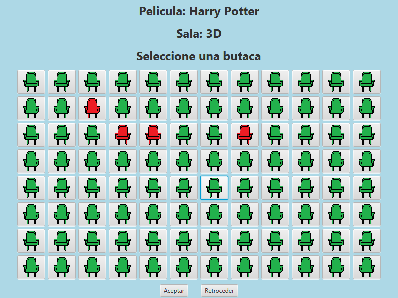

# SEGUNDO PARCIAL DE PROGRAMACIÓN 2 - MAURICIO HARRIET
## Sobre el proyecto

Este proyecto es una aplicación de escritorio desarrollada en Java. Es un sistema básico de ventas de entradas de un cine.
La aplicación permite:
- Registrarse y/o iniciar sesión en el sistema.
- Seleccionar peliculas.
- Seleccionar la butaca que quiera el cliente.
- Realizar la compra de la entrada.

La aplicación está diseñada para ser fácil y proporcionar una experiencia sencilla para el cliente.

Esta aplicación fue desarrollada con Java & JavaFX. Este proyecto es de mi autoría, pero la aplicación de conceptos se da en base a los conocimientos vistos en las clases de Programación 2 y Laboratorio 2.
